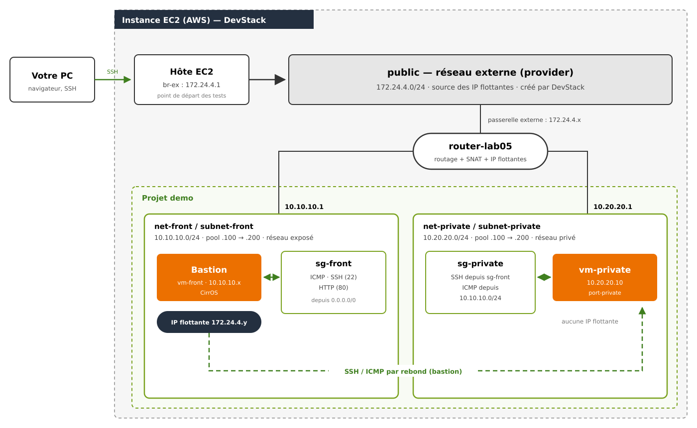

# Lab 05 — Neutron : isoler des instances privées derrière un bastion


## Objectifs

1. Créer des réseaux self-service (tenant) et leurs sous-réseaux, avec un plan d'adressage maîtrisé.
2. Donner un accès externe au réseau exposé grâce à un routeur connecté au réseau `public`.
3. Relier un réseau privé au même routeur, sans lui attribuer d'IP flottante.
4. Créer des groupes de sécurité, les attacher aux instances et aux ports, et appliquer le moindre privilège pour que les instances privées ne soient joignables que depuis le bastion.
5. Administrer une instance privée par rebond SSH via une instance bastion.

---

## 1. Scénario du lab

Vous allez construire, dans le projet `demo`, une architecture à deux réseaux :

- un réseau **exposé** (`net-front`, 10.10.10.0/24), qui héberge une instance **bastion** (`vm-front`) joignable depuis l'extérieur grâce à une IP flottante ;
- un réseau **privé** (`net-private`, 10.20.20.0/24), qui héberge une instance **sans IP flottante** (`vm-private`), joignable uniquement depuis le bastion.

Un routeur unique, `router-lab05`, relie les deux réseaux entre eux et au réseau externe `public`.




Les communications autorisées dans cette architecture sont les suivantes :

- `vm-front` est joignable en **ICMP, SSH et HTTP** depuis l'hôte EC2, via son IP flottante ;
- `vm-private` n'est **pas** joignable directement depuis l'extérieur ; elle est administrée en SSH **par rebond** via `vm-front` ;
- `vm-private` peut **sortir** vers l'extérieur (mises à jour, téléchargements) grâce au SNAT du routeur ;
- seules les instances portant le groupe `sg-front` peuvent joindre `vm-private` en SSH, selon les règles des groupes de sécurité.

### Ressources du lab

| Ressource | Nom | Paramètres |
|---|---|---|
| Réseau externe | `public` | créé par DevStack, 172.24.4.0/24 |
| Réseau / sous-réseau exposé | `net-front` / `subnet-front` | 10.10.10.0/24, passerelle .1, pool .100 → .200, DNS 8.8.8.8 |
| Réseau / sous-réseau privé | `net-private` / `subnet-private` | 10.20.20.0/24, passerelle .1, pool .100 → .200, DNS 8.8.8.8 |
| Routeur | `router-lab05` | passerelle sur `public`, interfaces sur les deux sous-réseaux |
| Port réservé | `port-private` | 10.20.20.10 sur `subnet-private` |
| Groupes de sécurité | `sg-front`, `sg-private` | voir Partie 6 |
| Instances | `vm-front`, `vm-private` | CirrOS, gabarit `m1.tiny` |
| Paire de clés | `lab05-key` | fichier `~/.ssh/lab05` |

### Plan d'adressage d'un sous-réseau

| Adresses | Usage |
|---|---|
| `.0` | adresse du réseau |
| `.1` | passerelle : interface du routeur |
| `.2` → `.99` | réservées : adresses choisies à la main (ex. `vm-private` en .10) |
| `.100` → `.200` | *allocation pool* : adresses attribuées automatiquement par Neutron |
| `.201` → `.254` | réservées |
| `.255` | adresse de diffusion |

---

## 2. Avant de commencer

Si votre instance EC2 a été arrêtée depuis la dernière séance, exécutez le script `restore_after_reboot.sh` du dossier `common/` du dépôt du cours.

Tout le lab se fait avec le compte **`demo`** : un réseau self-service se crée sans privilège administrateur.

```bash
source ~/devstack/openrc demo demo
openstack network list
```

Si la dernière commande affiche une liste de réseaux, votre environnement est prêt.

---
## Partie 1 — Explorer les réseaux existants

DevStack a déjà créé quelques objets réseau à l'installation. Avant de construire les vôtres, repérez ce qui existe.

```bash
openstack network list
openstack network list --external
openstack network show public -c name -c router:external -c mtu -c subnets
openstack subnet list
openstack router list
```

> **Question Q1.1** — Quel réseau est marqué comme *external* ? Quelle est la plage de son sous-réseau **IPv4** ? (Il possède aussi un sous-réseau IPv6, que nous n'utiliserons pas.)

> **Question Q1.2** — `public` est-il un réseau *provider* ou un réseau *tenant* ? Pouvez-vous, avec le compte `demo`, créer un réseau de ce type ? Pourquoi ?

> **Question Q1.3** — DevStack a aussi créé un réseau `private`, un réseau `shared` et un routeur `router1`. Ces objets ne seront **pas** utilisés dans ce lab : ne les modifiez pas.

---

## Partie 2 — Créer le réseau exposé

Un **réseau** Neutron joue le rôle d'un switch ; le **sous-réseau** est le plan d'adressage posé dessus. Vous décrivez le sous-réseau (plage, passerelle, pool, DNS) : Neutron choisit les adresses des instances, et le DHCP les leur transmet au démarrage.

### 2.1 Réseau et sous-réseau

```bash
openstack network create net-front

openstack subnet create subnet-front \
  --network net-front \
  --subnet-range 10.10.10.0/24 \
  --gateway 10.10.10.1 \
  --allocation-pool start=10.10.10.100,end=10.10.10.200 \
  --dns-nameserver 8.8.8.8 \
  --dhcp
```

Vérifiez :

```bash
openstack subnet show subnet-front \
  -c cidr -c gateway_ip -c allocation_pools -c enable_dhcp -c dns_nameservers
openstack port list --network net-front --long
```

> **Question Q2.1** — Quel est le rôle de l'*allocation pool* ? Quelles adresses du sous-réseau ne seront jamais attribuées **automatiquement** par Neutron à une instance ?

> **Question Q2.2** — Que se passerait-il pour les instances démarrées sur ce sous-réseau s'il avait été créé avec `--no-dhcp` ?

> **Question Q2.3** — Un port existe déjà sur `net-front` alors qu'aucune instance n'est lancée. Relevez son adresse IP et son `device_owner`. D'où vient cette adresse ? (Ce port technique, de type `network:distributed`, sert au service de métadonnées des instances. Son statut `DOWN` est normal.)

---

## Partie 3 — Donner un accès externe au réseau exposé via un routeur

Le **routeur** relie des sous-réseaux entre eux et les fait sortir vers le réseau externe. Il prend l'adresse de passerelle (`.1`) de chaque sous-réseau auquel il est raccordé, et une adresse sur `public`.

```bash
openstack router create router-lab05
openstack router set router-lab05 --external-gateway public
openstack router add subnet router-lab05 subnet-front
```

Vérifiez :

```bash
openstack router show router-lab05 -c external_gateway_info -c interfaces_info
openstack port list --router router-lab05 --long
```

> **Question Q3.1** — Quelle adresse IPv4 le routeur a-t-il sur `public` ? Laquelle sur `subnet-front` ? Pourquoi cette dernière est-elle égale à la passerelle du sous-réseau ?

> **Question Q3.2** — Quel est le `device_owner` du port affiché par `openstack port list --router` ? Le port du routeur sur `public` n'apparaît pas : pourquoi le projet `demo` ne le voit-il pas ?

> **Question Q3.3** — Dans `external_gateway_info`, repérez `enable_snat`. Que permet le SNAT aux instances de `net-front` ? Quelqu'un de l'extérieur peut-il joindre une de ces instances grâce au seul SNAT ?

---

## Partie 4 — Créer le réseau privé et le relier au routeur

Le réseau privé est raccordé au **même routeur** : c'est lui qui permettra le trafic entre `net-front` et `net-private`.

```bash
openstack network create net-private

openstack subnet create subnet-private \
  --network net-private \
  --subnet-range 10.20.20.0/24 \
  --gateway 10.20.20.1 \
  --allocation-pool start=10.20.20.100,end=10.20.20.200 \
  --dns-nameserver 8.8.8.8 \
  --dhcp

openstack router add subnet router-lab05 subnet-private
```

On veut que `vm-private` ait toujours la même adresse : on crée donc son **port** à l'avance, avec une adresse choisie hors de l'allocation pool.

```bash
openstack port create port-private \
  --network net-private \
  --fixed-ip subnet=subnet-private,ip-address=10.20.20.10
```

Vérifiez :

```bash
openstack port show port-private -c fixed_ips -c status -c device_owner -c security_group_ids
openstack port list --router router-lab05 --long
```

> **Question Q4.1** — Deux instances sur des réseaux différents ne peuvent communiquer que via un routeur. Quel objet permet maintenant le trafic entre `net-front` et `net-private` ? Combien d'interfaces internes `router-lab05` possède-t-il désormais ?

> **Question Q4.2** — Pourquoi est-il utile de créer le port avant l'instance ? Pourquoi a-t-on choisi `10.20.20.10`, hors de l'allocation pool ? Quel est le statut du port, et son `device_owner` est-il renseigné ? Pourquoi ?

> **Question Q4.3** — `vm-private` pourra-t-elle joindre l'extérieur (sortant) ? L'extérieur pourra-t-il joindre `vm-private` (entrant) ? Justifiez.

---

## Partie 5 — Lancer les instances (avec le groupe de sécurité par défaut)

Les instances sont d'abord lancées **sans groupe de sécurité particulier** : elles reçoivent le groupe `default` du projet. Observez ce qu'il autorise et ce qu'il bloque.

### 5.1 Paire de clés

```bash
ssh-keygen -t rsa -b 2048 -f ~/.ssh/lab05 -N ""
openstack keypair create --public-key ~/.ssh/lab05.pub lab05-key
```

### 5.2 Instances

| Instance | Image | Gabarit | Raccordement | Clé |
|---|---|---|---|---|
| `vm-front` | CirrOS | `m1.tiny` | réseau `net-front` (adresse choisie par Neutron) | `lab05-key` |
| `vm-private` | CirrOS | `m1.tiny` | port `port-private` (10.20.20.10) | `lab05-key` |

```bash
IMAGE=$(openstack image list -f value -c Name | grep -m1 cirros)
echo $IMAGE

openstack server create vm-front \
  --image "$IMAGE" --flavor m1.tiny \
  --network net-front --key-name lab05-key --wait

openstack server create vm-private \
  --image "$IMAGE" --flavor m1.tiny \
  --port port-private --key-name lab05-key --wait

openstack server list
```

### 5.3 IP flottante pour le bastion

Une **IP flottante** est une adresse du réseau `public` associée à une instance. Le routeur traduit cette adresse vers l'adresse privée de l'instance.

```bash
FIP_FRONT=$(openstack floating ip create public --description lab05 -f value -c floating_ip_address)
echo $FIP_FRONT
openstack server add floating ip vm-front $FIP_FRONT
```

> **Astuce.** La variable `FIP_FRONT` est perdue si vous fermez votre session SSH. Pour la retrouver : `openstack floating ip list`, puis `FIP_FRONT=<adresse>`.

### 5.4 Premiers tests

Depuis l'hôte EC2 :

```bash
ping -c 3 -W 2 $FIP_FRONT
ssh -o ConnectTimeout=5 -i ~/.ssh/lab05 cirros@$FIP_FRONT
```

> **Question Q5.1** — Le ping et le SSH fonctionnent-ils ? Exécutez `openstack security group rule list default` : quelles règles contient le groupe `default`, et pourquoi vous bloquent-elles ? (Ne corrigez rien pour l'instant : c'est l'objet de la Partie 6.)

---
## Partie 6 — Créer et attacher les groupes de sécurité

Un **groupe de sécurité** est un pare-feu appliqué à chaque port :

- c'est une **liste blanche** : tout ce qui n'est pas explicitement autorisé est refusé ;
- il est **stateful** : si une connexion est autorisée, ses réponses passent automatiquement ;
- une règle peut désigner sa source par une **plage d'adresses** (`--remote-ip`) ou par un **autre groupe** (`--remote-group`).

### 6.1 Groupe de sécurité du réseau exposé

`vm-front` joue le rôle de **bastion et serveur web** : elle accepte ICMP, SSH et HTTP depuis n'importe où.

**sg-front — règles entrantes (Ingress)**

| Type | Protocole | Port | Source |
|---|---|---|---|
| ICMP | ICMP | — | 0.0.0.0/0 |
| SSH | TCP | 22 | 0.0.0.0/0 |
| HTTP | TCP | 80 | 0.0.0.0/0 |

```bash
openstack security group create sg-front --description "Front: public access"

openstack security group rule create sg-front --ingress --protocol icmp --remote-ip 0.0.0.0/0
openstack security group rule create sg-front --ingress --protocol tcp --dst-port 22 --remote-ip 0.0.0.0/0
openstack security group rule create sg-front --ingress --protocol tcp --dst-port 80 --remote-ip 0.0.0.0/0

openstack security group rule list sg-front
```

> **Question** — Justifiez les règles entrantes de `sg-front`. Laquelle pourriez-vous restreindre dans un environnement de production, et comment ?

### 6.2 Groupe de sécurité du réseau privé

`vm-private` doit être joignable **uniquement depuis le bastion** (SSH) et depuis le réseau exposé (ICMP).

**sg-private — règles entrantes (Ingress)**

| Type | Protocole | Port | Source |
|---|---|---|---|
| SSH | TCP | 22 | groupe `sg-front` (*remote group*) |
| ICMP | ICMP | — | 10.10.10.0/24 (*remote IP*) |

```bash
openstack security group create sg-private --description "Private: access from front only"

openstack security group rule create sg-private --ingress --protocol tcp --dst-port 22 --remote-group sg-front
openstack security group rule create sg-private --ingress --protocol icmp --remote-ip 10.10.10.0/24

openstack security group rule list sg-private
```

> **Question Q6.1** — Quelles règles existent dans `sg-front` et `sg-private` que vous n'avez **pas** créées ? Que permettent-elles ?

> **Question Q6.2** — Quelle est la différence entre `--remote-ip 10.10.10.0/24` et `--remote-group sg-front` ? Laquelle est la plus robuste si le réseau exposé reçoit un deuxième sous-réseau, ou si une nouvelle instance y est ajoutée ?

### 6.3 Attacher les groupes de sécurité

Les groupes de sécurité s'appliquent aux **ports**. On peut les attacher via l'instance (Nova les applique à ses ports) ou directement sur le port.

**Méthode 1 — sur l'instance (`vm-front`) :**

```bash
openstack server add security group vm-front sg-front
openstack server remove security group vm-front default
openstack server show vm-front -c security_groups
```

**Méthode 2 — sur le port (`vm-private`) :**

```bash
openstack port set port-private --no-security-group --security-group sg-private
openstack port show port-private -c security_group_ids -c fixed_ips
```

> **Remarque.** `--no-security-group` retire d'abord le groupe `default`. Sans cette option, `sg-private` s'ajouterait à `default` au lieu de le remplacer.

**Récapitulatif**

| Instance | Port | Groupe de sécurité | IP flottante |
|---|---|---|---|
| `vm-front` | port créé par Nova sur `net-front` | `sg-front` | oui |
| `vm-private` | `port-private` (10.20.20.10) | `sg-private` | non |

### 6.4 Tester la matrice d'accès

Depuis l'hôte EC2, testez l'accès au bastion :

```bash
ping -c 3 $FIP_FRONT
ssh -i ~/.ssh/lab05 cirros@$FIP_FRONT
```

Joignez ensuite `vm-private` **en passant par** `vm-front`, utilisée comme bastion. L'agent SSH garde votre clé en mémoire : elle n'est jamais copiée sur le bastion.

```bash
eval $(ssh-agent)
ssh-add ~/.ssh/lab05
ssh -J cirros@$FIP_FRONT cirros@10.20.20.10
```

> Si le rebond échoue, connectez-vous d'abord à `vm-front`, puis lancez `ssh cirros@10.20.20.10` depuis celle-ci (mot de passe `gocubsgo`).

Depuis `vm-private`, testez l'accès sortant :

```bash
ping -c 3 10.10.10.1     # passerelle du réseau exposé (routeur)
ping -c 3 172.24.4.1     # côté réseau externe (hôte EC2, br-ex)
```

Complétez le tableau (Oui / Non) et expliquez chaque ligne :

| # | Depuis | Vers | Protocole | Résultat | Règle ou objet responsable |
|---|---|---|---|---|---|
| 1 | Hôte EC2 | `vm-front` (IP flottante) | ICMP | | |
| 2 | Hôte EC2 | `vm-front` (IP flottante) | SSH | | |
| 3 | `vm-front` | `vm-private` | ICMP | | |
| 4 | `vm-front` | `vm-private` | SSH | | |
| 5 | Hôte EC2 | `vm-private` (10.20.20.10) | ICMP | | |
| 6 | `vm-private` | 172.24.4.1 | ICMP | | |
| 7 | `vm-private` | `vm-front` | ICMP | | |

> **Question Q6.3** — Pensez au **trafic de retour** des lignes 4 et 6. À la ligne 6, aucune règle entrante de `sg-private` n'autorise les réponses venant de 172.24.4.1, et pourtant elles arrivent. Les groupes de sécurité sont *stateful* : qu'est-ce que cela signifie ?

> **Question Q6.4** — Proposez la règle à ajouter (avec ses options) qui permettrait à l'hôte EC2 de se connecter en SSH **directement** à `vm-private`, uniquement depuis `172.24.4.1`. Pourquoi préfère-t-on en général l'approche bastion ?

### 6.5 Pour aller plus loin (facultatif)

> **Question Q6.5 — Modification à chaud (HTTP).** Sur `vm-front`, démarrez un serveur web minimal, puis testez-le depuis l'hôte EC2 avec `curl http://$FIP_FRONT` :
>
> ```bash
> while true; do echo -e "HTTP/1.0 200 OK\r\n\r\nHello from vm-front" | sudo nc -l -p 80; done &
> ```
>
> Supprimez la règle du port 80 de `sg-front` (`openstack security group rule list sg-front`, puis `openstack security group rule delete <ID>`) et testez à nouveau. Faut-il redémarrer l'instance pour que le changement s'applique ?

> **Question Q6.6 — Moindre privilège.** Allouez une deuxième IP flottante et associez-la à `vm-private` :
>
> ```bash
> FIP_PRIV=$(openstack floating ip create public --description lab05 -f value -c floating_ip_address)
> openstack server add floating ip vm-private $FIP_PRIV
> ping -c 3 -W 2 $FIP_PRIV
> ssh -o ConnectTimeout=5 -i ~/.ssh/lab05 cirros@$FIP_PRIV
> ```
>
> Cela fonctionne-t-il ? Qu'est-ce qui protège `vm-private` alors qu'elle est maintenant « exposée » ? Retirez ensuite l'IP flottante :
>
> ```bash
> openstack server remove floating ip vm-private $FIP_PRIV
> openstack floating ip delete $FIP_PRIV
> ```

---

## Partie 7 — Observer la topologie

Dans Horizon : **Projet → Réseau → Topologie réseau**. Comparez avec le schéma de la section 1 et faites une capture de votre topologie pour votre compte rendu.

---

## Partie 8 — Nettoyage

Chaque lab doit laisser le projet propre pour que le lab suivant puisse repartir de zéro. Exécutez le script fourni :

```bash
bash clean_lab05.sh
```

Vérifiez qu'il ne reste rien de ce lab :

```bash
openstack server list
openstack floating ip list
openstack router list
openstack network list
openstack security group list
openstack keypair list
```

Seuls les objets créés par DevStack (`public`, `private`, `shared`, `router1`, groupe `default`) doivent subsister.

---

Les commandes utilisées dans ce lab sont résumées dans l'[aide-mémoire des commandes](./command-reference.md).
