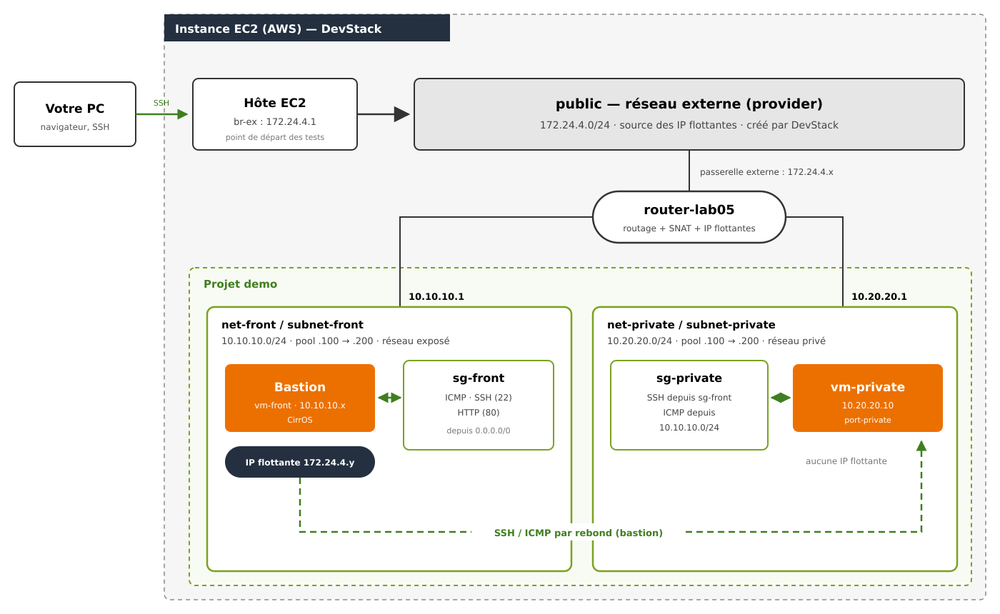

# Lab 06 — Infrastructure as Code : provisionner OpenStack avec OpenTofu

## Objectifs

1. Configurer **OpenTofu** pour dialoguer avec les API d'OpenStack via le fichier `clouds.yaml`.
2. Traduire l'architecture bastion du Lab 05 en code déclaratif HCL.
3. Utiliser une **data source** pour interroger Neutron sans coder d'identifiant en dur.
4. Comprendre le rôle du **state** et la gestion des dépendances implicites et explicites.
5. Observer et corriger une dérive de configuration (**drift**) introduite hors du code.

---

## 1. Scénario et architecture cible

Au **Lab 05**, vous avez construit pas à pas, avec des commandes `openstack ...`, une architecture à deux réseaux reliés par un routeur (`router-lab05`), avec un bastion (`vm-front`) et une instance privée (`vm-private`) joignable uniquement par rebond SSH. Vous avez ensuite exécuté `clean_lab05.sh` pour supprimer les ressources dans l'ordre inverse de leur création.

Dans ce lab, vous reconstruisez **exactement la même architecture** avec OpenTofu :

- la **partie publique** vous est fournie comme modèle ;
- vous **écrivez vous-même la partie privée** ;
- vous provoquez ensuite un **drift** pour observer comment OpenTofu ramène l'infrastructure à l'état décrit dans le code.



### Correspondance CLI (Lab 05) → OpenTofu (Lab 06)

| Ressource du Lab 05 | Nom dans OpenStack | Bloc OpenTofu |
|---|---|---|
| Image CirrOS | `cirros-...` | `variable "image_name"` |
| Gabarit | `m1.tiny` | `variable "flavor_name"` |
| Réseau externe (lecture) | `public` | `data "openstack_networking_network_v2"` |
| Paire de clés SSH | `lab06-key` | `openstack_compute_keypair_v2` |
| Réseaux | `net-front`, `net-private` | `openstack_networking_network_v2` |
| Sous-réseaux | `subnet-front`, `subnet-private` | `openstack_networking_subnet_v2` |
| Routeur | `router-lab05` | `openstack_networking_router_v2` |
| Interfaces du routeur | — | `openstack_networking_router_interface_v2` |
| Groupes de sécurité | `sg-front`, `sg-private` | `openstack_networking_secgroup_v2` |
| Règles de sécurité | ICMP, SSH, HTTP | `openstack_networking_secgroup_rule_v2` |
| Ports | `port-front`, `port-private` | `openstack_networking_port_v2` |
| Instances | `vm-front`, `vm-private` | `openstack_compute_instance_v2` |
| Allocation de l'IP flottante | — | `openstack_networking_floatingip_v2` |
| Association de l'IP flottante | — | `openstack_networking_floatingip_associate_v2` |

---

## Partie 1 — Installer OpenTofu et préparer l'authentification

Connectez-vous à votre instance EC2. Si elle a été redémarrée, exécutez `restore_after_reboot.sh` du dossier `common/`.

### 1.1 Installer OpenTofu

```bash
curl --proto '=https' --tlsv1.2 -fsSL https://get.opentofu.org/install-opentofu.sh -o install-opentofu.sh
chmod +x install-opentofu.sh
./install-opentofu.sh --install-method deb
rm -f install-opentofu.sh

tofu version
```

### 1.2 Vérifier le profil `demo` de `clouds.yaml`

OpenTofu lit le même fichier `~/.config/openstack/clouds.yaml` que la CLI et le SDK Python. Nous travaillons dans le projet **`demo`**.

Vérifiez d'abord si le fichier existe déjà :

```bash
cat ~/.config/openstack/clouds.yaml
```

- **S'il existe**, vérifiez qu'il contient une entrée `demo` ; sinon ajoutez-la à la main sous la clé `clouds:` (ne remplacez pas le fichier).
- **S'il n'existe pas**, créez-le :

```bash
mkdir -p ~/.config/openstack
cat > ~/.config/openstack/clouds.yaml <<'EOF'
clouds:
  demo:
    auth:
      auth_url: http://localhost/identity
      username: demo
      password: 'secret'
      project_name: demo
      user_domain_name: Default
      project_domain_name: Default
    region_name: RegionOne
    identity_api_version: 3
EOF
chmod 600 ~/.config/openstack/clouds.yaml
```

Supprimez de votre shell toutes les variables dont le nom commence par `OS_` (définies par `openrc`), pour éviter tout conflit avec `clouds.yaml` :

* Voir les variables dont le nom commence par `OS_` :

```bash
echo ${!OS_*}
```

* Supprimer toutes ces variables (attention : avec des accolades) :

```bash
unset ${!OS_*}
```

* Vérifier que le profil `demo` fonctionne : Keystone doit délivrer un jeton.

```bash
openstack --os-cloud demo token issue
```

* Vérifier qu'il ne reste aucune ressource des labs précédents dans le projet `demo` :

```bash
openstack --os-cloud demo server list
openstack --os-cloud demo router list
openstack --os-cloud demo network list
```

Résultat attendu :

- `server list` n'affiche aucune instance ;
- `router list` n'affiche que `router1`, créé par DevStack à l'installation ;
- `network list` n'affiche que les réseaux créés par DevStack (`public`, `private`…).
### 1.3 Préparer la clé SSH

```bash
ssh-keygen -t ed25519 -f ~/.ssh/lab06 -N ""
```

---

## Partie 2 — Déclaration du provider, variables et data sources

Avec OpenTofu, on ne tape plus des commandes pour créer l'infrastructure : on la **décrit** dans des fichiers texte, puis l'outil se charge de la créer. Cette description s'appelle la **configuration**, ou plus couramment le **code** OpenTofu.

- Ce code s'écrit dans des fichiers d'extension **`.tf`**, en langage **HCL** (HashiCorp Configuration Language).
- HCL est un langage **déclaratif** : on n'y écrit pas les étapes à exécuter, on y décrit l'état voulu (« un réseau nommé `net-front` doit exister »). OpenTofu compare cette description à ce qui existe réellement, puis en déduit les actions à mener.
- Le code est fait de **blocs**. Chaque bloc a un type (`provider`, `variable`, `data`, `resource`, `output`), un ou deux noms entre guillemets, et des arguments `nom = valeur` entre accolades.

### Les cinq types de blocs du lab

| Bloc | Rôle en une phrase | Fichier du lab |
|---|---|---|
| `provider` | Indique à quel cloud se connecter, et avec quel profil. | `providers.tf` |
| `variable` | Déclare un paramètre d'entrée, réutilisable avec `var.<nom>`. | `variables.tf` |
| `data` | Lit un objet qui existe déjà dans OpenStack. | `data.tf` |
| `resource` | Décrit un objet à créer et à gérer. | `network.tf`, `security.tf`, `compute.tf` |
| `output` | Affiche une valeur après le déploiement. | `outputs.tf` |

Le code est réparti dans plusieurs fichiers `.tf` du même répertoire : OpenTofu les lit tous comme un seul ensemble. Ce découpage sert uniquement à la lisibilité.

### Choisir le bon type de bloc

Avant d'écrire le moindre fichier, il faut décider, pour chaque objet du lab, s'il sera une variable, une data source ou une ressource. La règle tient en trois questions :

| Question | Bloc |
|---|---|
| L'objet doit-il être **créé** par ce code ? | `resource` |
| L'objet existe déjà, et il faut le **chercher** parce que son identifiant n'est pas connu ? | `data` |
| La valeur est **connue exactement**, mais peut changer d'un déploiement à l'autre ? | `variable` |

Appliquée aux objets du lab, elle donne le classement suivant :

| Objet | Bloc | Raison |
|---|---|---|
| Profil `clouds.yaml`, clé publique SSH | `variable` | Valeurs connues, qui dépendent de la machine et de l'utilisateur |
| Image CirrOS, gabarit `m1.tiny` | `variable` | Objets créés par DevStack, mais désignés par leur nom exact : le provider retrouve lui-même l'identifiant |
| Plages d'adresses, IP fixe de `vm-private` | `variable` | Plan d'adressage, réglable sans toucher au reste du code |
| Réseau externe `public` | `data` | Créé par DevStack. Le routeur exige son **identifiant**, différent sur chaque installation : il faut le chercher |
| Réseaux, sous-réseaux, routeur, ports, groupes de sécurité, clé Nova, instances, IP flottante | `resource` | Objets que le lab crée lui-même |

> **Remarque.** L'image et le gabarit existent déjà dans OpenStack, comme le réseau `public`. Ils pourraient donc aussi être lus par une data source. On a choisi une variable parce que leur nom suffit à les désigner. Ce n'est pas le cas du réseau `public`, dont le routeur réclame l'identifiant.

Ce classement donne la structure des fichiers que vous allez écrire :

| Fichier | Contenu |
|---|---|
| `providers.tf` | Le provider OpenStack et le profil de connexion |
| `variables.tf` | Les 7 variables du lab |
| `data.tf` | La lecture du réseau `public` |
| `network.tf`, `security.tf`, `compute.tf` | Les ressources, regroupées par service |
| `outputs.tf` | Les valeurs à afficher après le déploiement |

### 2.1 Créer le répertoire de travail

```bash
mkdir -p ~/lab06-opentofu && cd ~/lab06-opentofu
```

> Toutes les commandes `tofu` de ce lab se lancent depuis `~/lab06-opentofu`. En cas d'erreur inattendue, commencez par vérifier votre position avec `pwd`.

> **Attention.** Les blocs marqués `hcl` dans cet énoncé ne sont **pas** des commandes : ce sont des contenus de fichiers. Ne les collez pas dans le terminal. Pour chaque fichier, ouvrez un éditeur (`nano <fichier>.tf`), collez le contenu, enregistrez (Ctrl+O) et quittez (Ctrl+X). Seuls les blocs marqués `bash` s'exécutent dans le terminal.

### 2.2 Déclarer le provider (`providers.tf`)

Ce fichier contient deux blocs : le premier dit **de quoi OpenTofu a besoin** pour exécuter le code, le second dit **comment se connecter** à OpenStack.

```bash
nano providers.tf
```

```hcl
terraform {
  required_version = ">= 1.6.0"

  required_providers {
    openstack = {
      source  = "terraform-provider-openstack/openstack"
      version = "~> 3.0"
    }
  }
}

provider "openstack" {
  cloud = var.cloud_name
}
```

> **Question Q2.1** — Le bloc `provider` ne contient ni mot de passe ni URL : il référence seulement un profil de `clouds.yaml`. Pourquoi est-ce préférable à l'écriture de `user_name`, `password` et `auth_url` directement dans un fichier `.tf` ?

### 2.3 Initialiser le projet

```bash
tofu init
```

> **Pourquoi initialiser maintenant ?** `tofu init` ne lit que le bloc `required_providers` : il télécharge le plugin OpenStack, sans tenir compte des ressources. Une fois le projet initialisé, `tofu validate` et `tofu plan` peuvent vérifier chaque fichier au fur et à mesure que vous l'écrivez. Il n'est pas nécessaire de relancer `tofu init` quand vous ajoutez des ressources, seulement si vous changez de provider ou de version.

Vérification, depuis `~/lab06-opentofu` (les fichiers commençant par un point sont cachés, d'où l'option `-a`) :

```bash
ls -a
find .terraform -type f
cat .terraform.lock.hcl
```

> **Question Q2.2** — Qu'a téléchargé la commande `tofu init`, et dans quel répertoire caché ces fichiers sont-ils stockés ? Quel est le rôle du fichier `.terraform.lock.hcl` ?

Vérifiez maintenant la configuration :

```bash
tofu validate
```

> **Question Q2.3** — `tofu validate` répond `Success!`, alors que `providers.tf` utilise `var.cloud_name` et qu'aucun fichier ne déclare encore cette variable. Qu'est-ce que `tofu validate` vérifie, et qu'est-ce qu'il ne vérifie pas ? Pourquoi ne peut-on pas encore lancer de déploiement ?

### 2.4 Déclarer les variables (`variables.tf`)

Ce fichier ne crée rien dans OpenStack. Il déclare les **paramètres** du code : des valeurs nommées, définies à un seul endroit, que les autres fichiers réutilisent sous la forme `var.<nom>`.

Relevez d'abord le nom exact de l'image CirrOS installée. Si votre nom diffère de `cirros-0.6.3-x86_64-disk`, corrigez la valeur par défaut de `image_name` ci-dessous :

```bash
openstack --os-cloud demo image list
```

```bash
nano variables.tf
```

```hcl
variable "cloud_name" {
  description = "Nom du profil dans clouds.yaml"
  type        = string
  default     = "demo"
}

variable "public_key_path" {
  description = "Chemin vers la clé publique SSH à importer dans Nova"
  type        = string
  default     = "~/.ssh/lab06.pub"
}

variable "image_name" {
  description = "Nom exact de l'image utilisée pour les instances"
  type        = string
  default     = "cirros-0.6.3-x86_64-disk"
}

variable "flavor_name" {
  description = "Gabarit utilisé pour les instances"
  type        = string
  default     = "m1.tiny"
}

variable "front_cidr" {
  description = "Plage d'adresses du sous-réseau exposé"
  type        = string
  default     = "10.10.10.0/24"
}

variable "private_cidr" {
  description = "Plage d'adresses du sous-réseau privé"
  type        = string
  default     = "10.20.20.0/24"
}

variable "private_vm_ip" {
  description = "Adresse IP fixe réservée à vm-private"
  type        = string
  default     = "10.20.20.10"
}
```

Relancez la vérification : l'erreur doit avoir disparu.

```bash
tofu validate
```

> **Question Q2.4** — OpenTofu va utiliser le profil désigné par `var.cloud_name`. Dans quel fichier se trouve ce profil ? Ouvrez-le et relevez le projet et l'utilisateur utilisés.

### 2.5 Lire le réseau externe (`data.tf`)

Ce fichier ne crée rien non plus. Un bloc `data`, appelé **data source**, interroge OpenStack pour récupérer des informations sur un objet **qui existe déjà**. Ici, il lit le réseau externe `public`, créé par DevStack à l'installation, dont le routeur aura besoin.

```bash
nano data.tf
```

```hcl
data "openstack_networking_network_v2" "public" {
  name     = "public"
  external = true
}
```

```bash
tofu validate
```

> **Question Q2.5** — Le réseau `public` est déclaré dans un bloc `data` et non dans un bloc `resource`. Pourquoi ce choix ? Qu'arriverait-il à ce réseau lors d'un `tofu destroy` dans un cas, et dans l'autre ?

---

## Partie 3 — Déployer le socle public

### 3.1 Réseau exposé, routeur et port du bastion (`network.tf`)

```bash
nano network.tf
```

```hcl
resource "openstack_networking_router_v2" "router" {
  name                = "router-lab05"
  external_network_id = data.openstack_networking_network_v2.public.id
}

resource "openstack_networking_network_v2" "front" {
  name = "net-front"
}

resource "openstack_networking_subnet_v2" "front" {
  name       = "subnet-front"
  network_id = openstack_networking_network_v2.front.id
  cidr       = var.front_cidr
  ip_version = 4
  gateway_ip = "10.10.10.1"

  allocation_pool {
    start = "10.10.10.100"
    end   = "10.10.10.200"
  }

  dns_nameservers = ["8.8.8.8"]
}

resource "openstack_networking_router_interface_v2" "front" {
  router_id = openstack_networking_router_v2.router.id
  subnet_id = openstack_networking_subnet_v2.front.id
}

resource "openstack_networking_port_v2" "front" {
  name               = "port-front"
  network_id         = openstack_networking_network_v2.front.id
  security_group_ids = [openstack_networking_secgroup_v2.front.id]

  fixed_ip {
    subnet_id = openstack_networking_subnet_v2.front.id
  }
}
```

### 3.2 Sécurité du bastion (`security.tf`)

```bash
nano security.tf
```

```hcl
resource "openstack_networking_secgroup_v2" "front" {
  name        = "sg-front"
  description = "Front: public access (managed by OpenTofu)"
}

resource "openstack_networking_secgroup_rule_v2" "front_icmp" {
  direction         = "ingress"
  ethertype         = "IPv4"
  protocol          = "icmp"
  remote_ip_prefix  = "0.0.0.0/0"
  security_group_id = openstack_networking_secgroup_v2.front.id
}

resource "openstack_networking_secgroup_rule_v2" "front_ssh" {
  direction         = "ingress"
  ethertype         = "IPv4"
  protocol          = "tcp"
  port_range_min    = 22
  port_range_max    = 22
  remote_ip_prefix  = "0.0.0.0/0"
  security_group_id = openstack_networking_secgroup_v2.front.id
}

resource "openstack_networking_secgroup_rule_v2" "front_http" {
  direction         = "ingress"
  ethertype         = "IPv4"
  protocol          = "tcp"
  port_range_min    = 80
  port_range_max    = 80
  remote_ip_prefix  = "0.0.0.0/0"
  security_group_id = openstack_networking_secgroup_v2.front.id
}
```

### 3.3 Bastion et IP flottante (`compute.tf`)

```bash
nano compute.tf
```

```hcl
resource "openstack_compute_keypair_v2" "lab06" {
  name       = "lab06-key"
  public_key = file(pathexpand(var.public_key_path))
}

resource "openstack_compute_instance_v2" "vm_front" {
  name        = "vm-front"
  image_name  = var.image_name
  flavor_name = var.flavor_name
  key_pair    = openstack_compute_keypair_v2.lab06.name

  network {
    port = openstack_networking_port_v2.front.id
  }
}

resource "openstack_networking_floatingip_v2" "front" {
  pool        = data.openstack_networking_network_v2.public.name
  description = "lab06-front"
}

resource "openstack_networking_floatingip_associate_v2" "front" {
  floating_ip = openstack_networking_floatingip_v2.front.address
  port_id     = openstack_networking_port_v2.front.id

  depends_on = [openstack_networking_router_interface_v2.front]
}
```

### 3.4 Sortie (`outputs.tf`)

```bash
nano outputs.tf
```

```hcl
output "bastion_floating_ip" {
  description = "Adresse IP flottante de vm-front"
  value       = openstack_networking_floatingip_v2.front.address
}
```

### 3.5 Planifier et appliquer

Lisez le plan en entier avant de répondre `yes` :

```bash
tofu fmt
tofu validate
tofu plan
tofu apply
```

> Le résumé du plan doit annoncer **13 ressources à ajouter**. Si ce n'est pas le cas, relisez vos fichiers avant d'appliquer.

Inspectez le résultat des deux côtés, puis relancez `tofu apply` une seconde fois :

```bash
openstack --os-cloud demo server list
tofu state list
tofu state show openstack_networking_subnet_v2.front
tofu apply
```

Chargez la clé dans un agent SSH et connectez-vous au bastion :

```bash
eval $(ssh-agent)
ssh-add ~/.ssh/lab06

FIP=$(tofu output -raw bastion_floating_ip)
ssh cirros@$FIP
```

> Si SSH signale que l'identité de l'hôte a changé (IP flottante réutilisée d'un lab précédent), supprimez l'ancienne entrée avec `ssh-keygen -R $FIP`.

> **Question Q3.1** — Dans le plan, certains attributs sont affichés `(known after apply)`. Pourquoi ?

> **Question Q3.2** — Vous n'avez jamais indiqué à OpenTofu de créer le réseau avant le sous-réseau. Comment le sait-il ? Pourquoi l'association de l'IP flottante a-t-elle besoin, elle, d'un `depends_on` explicite vers l'interface du routeur ?

> **Question Q3.3** — Que fait le second `tofu apply` ? Quelle propriété des outils déclaratifs cela illustre-t-il ?

> **Question Q3.4** — Quel est le rôle du fichier `terraform.tfstate` ? Pourquoi ne doit-on jamais le modifier à la main ?

---

## Partie 4 — Compléter l'architecture privée

Ajoutez la **zone privée** du Lab 05 en complétant les fichiers existants, par analogie avec la partie publique et à l'aide de la documentation du provider OpenStack. Lancez `tofu plan` après chaque bloc pour détecter les erreurs au plus tôt.

> **Où trouver la syntaxe ?** Les types de ressources et leurs arguments sont décrits dans la documentation du provider OpenStack, classée par service : <https://registry.terraform.io/providers/terraform-provider-openstack/openstack/latest/docs>. Le code de la Partie 3 reste votre premier modèle : la partie privée utilise les mêmes types que la partie publique.

1. **Dans `network.tf` :**
   - un réseau `net-private` ;
   - un sous-réseau `subnet-private` (CIDR `var.private_cidr`, passerelle `10.20.20.1`, pool `.100` → `.200`, DNS `8.8.8.8`) ;
   - le raccordement de `subnet-private` à `router-lab05` ;
   - un port `port-private` sur `net-private`, avec l'IP fixe `var.private_vm_ip` et le groupe `sg-private`.

2. **Dans `security.tf` :**
   - un groupe de sécurité `sg-private` ;
   - une règle entrante **SSH (TCP 22)** uniquement depuis les membres de **`sg-front`** (attribut `remote_group_id` à la place de `remote_ip_prefix`) ;
   - une règle entrante **ICMP** uniquement depuis `var.front_cidr`.

3. **Dans `compute.tf` :**
   - une instance `vm-private` (image `var.image_name`, gabarit `var.flavor_name`, clé `lab06-key`), raccordée par `port-private`, **sans IP flottante**.

4. **Dans `outputs.tf` :**
   - une sortie `private_vm_ip` donnant l'adresse de `vm-private`, lue sur le port et non recopiée depuis la variable.

> **Aide.** Sur un `openstack_networking_port_v2`, seuls les groupes listés dans `security_group_ids` sont attachés : le groupe `default` n'est pas appliqué (équivalent de `--no-security-group --security-group sg-private` au Lab 05).

Vérifiez que le plan annonce **8 ressources à ajouter, 0 à modifier et 0 à détruire**, puis appliquez :

```bash
tofu plan
tofu apply
```

Testez le rebond SSH depuis l'hôte EC2, puis essayez d'atteindre `vm-private` directement :

```bash
FIP=$(tofu output -raw bastion_floating_ip)
PRIV_IP=$(tofu output -raw private_vm_ip)

ssh -J cirros@$FIP cirros@$PRIV_IP
ssh cirros@$PRIV_IP
```

> **Question Q4.1** — Lors de cet `apply`, OpenTofu n'a recréé ni `vm-front` ni `router-lab05`. Comment sait-il que ces ressources existent déjà ?

> **Question Q4.2** — Le groupe de sécurité est attaché au **port** (`security_group_ids`) et non à l'instance (`security_groups`). Pourquoi est-ce nécessaire quand une instance est raccordée par un port pré-créé ?

> **Question Q4.3** — L'accès direct à `vm-private` depuis l'hôte échoue. Quels éléments de votre code l'expliquent ?

---

## Partie 5 — Observer et corriger le drift

En production, il arrive qu'un administrateur intervienne en urgence par Horizon ou la CLI, ce qui crée un écart entre la **réalité** et l'**état décrit** dans le code.

### 5.1 Introduire trois changements manuels

1. Supprimez la règle HTTP (port 80) de `sg-front` :

```bash
openstack --os-cloud demo security group rule list sg-front
openstack --os-cloud demo security group rule delete <ID de la règle tcp 80:80>
```

2. Ajoutez une règle pour le port 8080 :

```bash
openstack --os-cloud demo security group rule create sg-front \
  --ingress --protocol tcp --dst-port 8080 --remote-ip 0.0.0.0/0
```

3. Renommez l'instance privée :

```bash
openstack --os-cloud demo server set --name vm-renamed vm-private
```

### 5.2 Détecter et réconcilier

```bash
tofu plan
```

> **Question Q5.1** — Qu'affiche `tofu plan` pour chacun des trois changements ? Utilisez les symboles du plan (`+`, `~`, `-`).

> **Question Q5.2** — Pourquoi la suppression de la règle 80 et le renommage sont-ils détectés, mais **pas** l'ajout de la règle 8080 ? (Indice : que contient le state ?)

Appliquez, puis vérifiez :

```bash
tofu apply
openstack --os-cloud demo security group rule list sg-front
openstack --os-cloud demo server list
```

> **Question Q5.3** — La règle 8080 est-elle toujours là après le `tofu apply` ? Qu'en déduisez-vous pour une équipe qui mélange changements manuels et IaC ?

Supprimez la règle 8080 à la main avant de continuer.

### 5.3 Modifier l'infrastructure par le code

1. Simulez un changement de plage d'adresses, **sans l'appliquer** :

```bash
tofu plan -var 'private_cidr=10.30.30.0/24'
```

2. Dans `security.tf`, modifiez la `description` de `sg-front`, puis lancez `tofu plan` et `tofu apply`.

> **Question Q5.4** — L'un des deux changements est annoncé `~ update in-place`, l'autre `-/+ must be replaced`. Lequel, pourquoi, et quelles ressources sont entraînées en cascade ?

---

## Partie 6 — Destruction de l'infrastructure

Au Lab 05, `clean_lab05.sh` supprimait les ressources dans un ordre écrit à la main. Ici, le graphe de dépendances s'en charge :

```bash
tofu destroy
```

Vérifiez que le projet `demo` est revenu à son état initial :

```bash
openstack --os-cloud demo server list
openstack --os-cloud demo floating ip list
openstack --os-cloud demo router list
openstack --os-cloud demo network list
openstack --os-cloud demo security group list
```

> **Question Q6.1** — Comparez l'ordre de destruction affiché par `tofu destroy` avec celui de `clean_lab05.sh`. Que sait OpenTofu qu'un script ne sait pas ?

> **Question Q6.2** — Que reste-t-il dans `terraform.tfstate` après le `destroy` ? Pourquoi ce fichier ne doit-il jamais être poussé dans un dépôt Git public ?