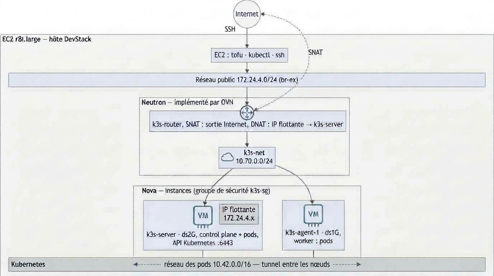

# Lab 07 — Un cluster Kubernetes (k3s) sur OpenStack


## Objectifs

À la fin de ce lab, vous serez capable de :

- construire avec la CLI `openstack` l'infrastructure d'un cluster Kubernetes : réseau, routeur, groupe de sécurité, **1 VM serveur** et **1 VM agent** ;
- installer **k3s** sur chaque VM et faire **rejoindre** l'agent au cluster ;
- vérifier le cluster avec `kubectl get nodes`, depuis le serveur puis depuis l'EC2 ;
- relier ce que voit Kubernetes (nœuds, pods) à ce que fournit OpenStack (instances, ports, réseaux).

> **k3s** est une distribution légère et certifiée de Kubernetes (projet de la CNCF) : mêmes objets, même API, même `kubectl`, mais un seul binaire et une installation en une commande. Le **server** porte le control plane ; l'**agent** est un nœud *worker* qui exécute les pods.

## Topologie




> La bande **Kubernetes** représente le réseau des pods (10.42.0.0/16). Ce n'est pas un réseau OpenStack : les pods tournent **à l'intérieur** des VM, et leur trafic d'un nœud à l'autre passe dans un tunnel transporté par `k3s-net`. Neutron ne voit que les IP des VM (10.70.0.x), jamais celles des pods. Ce tunnel est créé par **flannel**, le composant réseau inclus dans k3s.

### Les nœuds du cluster

| Nœud | Rôle Kubernetes | Gabarit | vCPU | RAM | IP privée | Accès |
|---|---|---|---|---|---|---|
| `k3s-server` | control plane + pods | `ds2G` | 2 | 2 Go | 10.70.0.10 | **IP flottante** 172.24.4.x |
| `k3s-agent-1` | worker (pods) | `ds1G` | 1 | 1 Go | 10.70.0.11 | rebond par le serveur |

### Plan d'adressage

| Réseau              | Plage         | Géré par             | Contient                             |
| ------------------- | ------------- | -------------------- | ------------------------------------ |
| Réseau public       | 172.24.4.0/24 | OpenStack (DevStack) | IP flottantes, passerelle du routeur |
| `k3s-net`           | 10.70.0.0/24  | OpenStack (Neutron)  | IP des VM                            |
| Réseau des pods     | 10.42.0.0/16  | Kubernetes (k3s)     | IP des pods                          |
| Réseau des Services | 10.43.0.0/16  | Kubernetes (k3s)     | IP virtuelles des Services (Lab 08)  |

> Les plages 10.42.0.0/16 (pods) et 10.43.0.0/16 (Services) sont les **valeurs par défaut de k3s**. On pourrait les changer à l'installation du serveur (`--cluster-cidr`, `--service-cidr`), mais jamais après. `k3s-net` ne doit pas les chevaucher : c'est pourquoi on a choisi 10.70.0.0/24.

### Flux réseau

| De | Vers | Port | Rôle |
|---|---|---|---|
| EC2 (étudiant) | `k3s-server` (IP flottante) | 22/tcp | SSH |
| EC2 (étudiant) | `k3s-server` (IP flottante) | 6443/tcp | `kubectl` → API Kubernetes |
| `k3s-agent-1` | `k3s-server` | 6443/tcp | l'agent rejoint le cluster |
| `k3s-server` ↔ `k3s-agent-1` | | 8472/udp | tunnel du réseau des pods |
| `k3s-server` ↔ `k3s-agent-1` | | 10250/tcp | kubelet (métriques, logs) |
| VM | Internet (via SNAT du routeur) | 443/tcp | téléchargement de k3s |

> Chaque flux entrant correspond à une règle du groupe de sécurité `k3s-sg` (section 2.2).

---

## 0. Avant de commencer

> Exécutez les deux scripts du dossier [`common/`](../common/) du dépôt, **dans cet ordre** :
>
> 1. **`restore_after_reboot.sh`** — remet DevStack en état après un redémarrage de l'EC2 ;
> 2. **`purge_all.sh`** — supprime toutes les ressources des labs précédents, pour démarrer sur un DevStack propre.
>
> Consultez `common/README.md` pour leur utilisation.

Toutes les commandes de ce lab s'exécutent avec l'utilisateur **demo** :

```bash
export OS_CLOUD=demo
```

## 1. Préparer l'image, la clé et `kubectl`

### 1.1. Préparer l'image

**Télécharger l'image Ubuntu.** Cirros ne suffit pas pour k3s : il faut une vraie distribution (systemd, `curl`, cloud-init complet). Tout le monde utilise la **même version datée** de l'image officielle Ubuntu 24.04 (*release 20261017*).

```bash
REL=20261017
BASE=https://cloud-images.ubuntu.com/releases/noble/release-$REL
wget -q --show-progress $BASE/ubuntu-24.04-server-cloudimg-amd64.img
wget -q $BASE/SHA256SUMS
sha256sum -c SHA256SUMS --ignore-missing      # attendu : ubuntu-24.04-server-cloudimg-amd64.img: OK
```

**Créer l'image dans Glance** (dans le même terminal, pour que `$REL` soit toujours défini) :

```bash
openstack image create ubuntu-24.04 \
  --disk-format qcow2 --container-format bare \
  --property cloudimg_release=$REL \
  --file ubuntu-24.04-server-cloudimg-amd64.img
```

**Vérifier l'image** — attendu : `status` = `active`, `size` ≈ 620 000 000 octets, `cloudimg_release='20261017'` dans `properties` :

```bash
openstack image show ubuntu-24.04 -c status -c visibility -c size -c properties
```

> L'image est créée dans le projet `demo` avec la visibilité `shared` ou `private` : c'est suffisant, car tout le lab se déroule dans ce même projet. Seul un administrateur peut publier une image `public`.

**Supprimer les fichiers téléchargés** (l'image est maintenant stockée dans Glance) :

```bash
rm ubuntu-24.04-server-cloudimg-amd64.img SHA256SUMS
```

### 1.2. Préparer la clé

**Clé SSH dédiée au lab.** On crée une paire de clés propre au Lab 07 :

```bash
ssh-keygen -t ed25519 -N "" -C "lab07" -f ~/.ssh/lab07
cat ~/.ssh/lab07.pub
```

> Deux fichiers sont créés : `~/.ssh/lab07` (clé **privée**, qui ne quitte jamais l'EC2) et `~/.ssh/lab07.pub` (clé **publique**, que Nova injectera dans les VM). Si `ssh-keygen` demande `Overwrite (y/n)?`, la clé existe déjà : répondez **n**.

**Configuration de `ssh`.** Par défaut, `ssh` n'essaie que les clés standard (`id_ed25519`, `id_rsa`…). Sans configuration, il faudrait ajouter `-i ~/.ssh/lab07` à chaque commande `ssh` et `scp` du lab. On indique donc une fois pour toutes, dans `~/.ssh/config`, quelle clé utiliser pour les adresses du cluster.

* Ouvrez le fichier `~/.ssh/config` (il est créé s'il n'existe pas) :

```bash
nano ~/.ssh/config
```

* Ajoutez ce bloc à la fin du fichier, puis enregistrez (`Ctrl+O`, `Entrée`, `Ctrl+X`) :

```text
# Lab 07 - cluster k3s (IP flottantes DevStack + réseau privé du cluster)
Host 172.24.4.* 10.70.0.*
  User ubuntu
  IdentityFile ~/.ssh/lab07
  StrictHostKeyChecking accept-new
```

> `Host` : les adresses concernées (IP flottantes et réseau privé du cluster). `User ubuntu` : l'utilisateur des images cloud Ubuntu. `IdentityFile` : la clé privée du lab. `StrictHostKeyChecking accept-new` : accepte automatiquement la clé d'hôte d'une **nouvelle** VM, mais refuse une clé **différente** pour une adresse déjà connue.

* Restreignez les droits du fichier (lecture et écriture pour vous seul — `ssh` refuse un fichier de configuration accessible aux autres utilisateurs) :

```bash
chmod 600 ~/.ssh/config
```

### 1.3. Installer `kubectl`

`kubectl` sur l'EC2 servira à piloter le cluster depuis l'extérieur :

```bash
curl -sLO "https://dl.k8s.io/release/$(curl -sL https://dl.k8s.io/release/stable.txt)/bin/linux/amd64/kubectl"
sudo install -m 0755 kubectl /usr/local/bin/kubectl && rm kubectl
kubectl version --client
```

> Les deux premières commandes n'affichent rien quand elles réussissent. Seule la dernière confirme l'installation (`Client Version: v1.3x.x`).

### 1.4. Vérifier les ressources disponibles

```bash
openstack flavor list -c Name -c RAM -c VCPUs -c Disk | grep -E "Name|ds1G|ds2G"
free -h
nproc
df -h /
```

> Le cluster consomme ≈ 3 Go de RAM (`ds2G` : 2 Go + `ds1G` : 1 Go). Sur une r8i.large (2 vCPU, 16 Gio), DevStack laisse ≈ 9 Gio disponibles : la mémoire n'est pas le problème. La limite est le **processeur** : les deux VM déclarent 3 vCPU, alors que l'hôte n'en a que 2, partagés avec tous les services DevStack. Les VM seront donc lentes à démarrer. Vérifiez seulement que `free -h` affiche au moins 4 Go disponibles et `df -h /` au moins 10 Go.

---

## 2. Construire l'infrastructure (couche OpenStack)

On crée, dans l'ordre, tout ce qui figure sur la topologie : le réseau, la sécurité, puis les deux VM.

### 2.1. Le réseau

```bash
openstack network create k3s-net
openstack subnet create k3s-subnet \
  --network k3s-net \
  --subnet-range 10.70.0.0/24 \
  --dns-nameserver 8.8.8.8 --dns-nameserver 1.1.1.1
openstack router create k3s-router
openstack router set k3s-router --external-gateway public
openstack router add subnet k3s-router k3s-subnet
```

> Le routeur relie `k3s-net` au réseau `public` : il fera la **SNAT** (les VM téléchargeront k3s depuis Internet) et la **DNAT** de l'IP flottante du serveur. Les serveurs DNS sont distribués aux VM par le DHCP de Neutron.

### 2.2. Le groupe de sécurité

Un seul groupe, `k3s-sg`, appliqué aux deux VM. Il contient deux types de règles :

```bash
openstack security group create k3s-sg --description "Lab 07 - noeuds du cluster k3s"

# Accès depuis l'EC2 (source : n'importe quelle adresse)
openstack security group rule create k3s-sg --protocol tcp  --dst-port 22   --remote-ip 0.0.0.0/0
openstack security group rule create k3s-sg --protocol icmp                 --remote-ip 0.0.0.0/0
openstack security group rule create k3s-sg --protocol tcp  --dst-port 6443 --remote-ip 0.0.0.0/0

# Trafic entre les nœuds du cluster (source : les membres du groupe lui-même)
openstack security group rule create k3s-sg --protocol tcp --dst-port 6443  --remote-group k3s-sg
openstack security group rule create k3s-sg --protocol udp --dst-port 8472  --remote-group k3s-sg
openstack security group rule create k3s-sg --protocol tcp --dst-port 10250 --remote-group k3s-sg

openstack security group rule list k3s-sg
```

| Règle | Port | Source | Rôle |
|---|---|---|---|
| SSH | 22/tcp | toute adresse | connexion depuis l'EC2 |
| ICMP | — | toute adresse | `ping` |
| API Kubernetes | 6443/tcp | toute adresse | `kubectl` depuis l'EC2 |
| API entre nœuds | 6443/tcp | membres de `k3s-sg` | l'agent s'enregistre auprès du serveur |
| Tunnel des pods | 8472/udp | membres de `k3s-sg` | trafic entre pods de nœuds différents |
| Kubelet | 10250/tcp | membres de `k3s-sg` | métriques, `kubectl logs` |

> Neutron ajoute aussi automatiquement deux règles **sortantes** (IPv4 et IPv6) qui autorisent tout le trafic au départ des VM.

> **Q1.** Les trois dernières règles utilisent `--remote-group k3s-sg` au lieu d'une adresse IP. Que signifie cette source ? Quel avantage cela apporte-t-il si l'on ajoute un deuxième agent plus tard ?

### 2.3. La paire de clés

```bash
openstack keypair create k3s-key --public-key ~/.ssh/lab07.pub
```

### 2.4. Les deux VM

Chaque VM reçoit une **adresse IP fixe** dans `k3s-net` : l'agent devra connaître l'adresse du serveur pour rejoindre le cluster.

```bash
NET_ID=$(openstack network show k3s-net -f value -c id)

openstack server create k3s-server \
  --image ubuntu-24.04 --flavor ds2G --key-name k3s-key \
  --nic net-id=$NET_ID,v4-fixed-ip=10.70.0.10 \
  --security-group k3s-sg --wait

openstack server create k3s-agent-1 \
  --image ubuntu-24.04 --flavor ds1G --key-name k3s-key \
  --nic net-id=$NET_ID,v4-fixed-ip=10.70.0.11 \
  --security-group k3s-sg --wait

openstack server list
```

> `--wait` rend la main quand la VM est `ACTIVE`.  Comptez quelques minutes par VM : la virtualisation est imbriquée.

**L'IP flottante du serveur** — seul le serveur est joignable depuis l'EC2 :

```bash
FIP=$(openstack floating ip create public -f value -c floating_ip_address)
openstack server add floating ip k3s-server $FIP
echo $FIP
```

**Sauvegarder les adresses** dans un fichier, pour les retrouver dans un nouveau terminal :

```bash
cat > ~/lab07.env <<EOF
FIP=$FIP
SERVER_IP=10.70.0.10
AGENT_IP=10.70.0.11
EOF
source ~/lab07.env
```

> Dans tout nouveau terminal : `source ~/lab07.env` et `export OS_CLOUD=demo`.

**Attendre que les VM soient prêtes** (démarrage terminé, clé SSH installée) :

```bash
ssh $FIP 'cloud-init status --wait'
ssh -J $FIP $AGENT_IP 'cloud-init status --wait'
```

> Si `ssh` répond `Connection refused` ou `Connection timed out`, la VM n'a pas fini de démarrer : attendez une minute et relancez.

> `ssh -J $FIP $AGENT_IP` se connecte à l'agent **en rebond** par le serveur : l'agent n'a pas d'IP flottante, il n'est joignable que depuis `k3s-net`.

> **Q2.** Pourquoi seul le serveur reçoit-il une IP flottante ? Par quel chemin (voir la topologie) votre commande `ssh` atteint-elle l'agent ?

---

## 3. Installer k3s (couche Kubernetes)

L'infrastructure est prête : deux VM Ubuntu vides. On installe maintenant Kubernetes, nœud par nœud. Les commandes sont lancées **depuis l'EC2** : `ssh <adresse> "commande"` exécute la commande sur la VM et affiche le résultat ici.

### 3.1. Vérifier l'accès à Internet depuis les VM

k3s se télécharge depuis Internet, via la SNAT du routeur :

```bash
ssh $FIP 'curl -sI https://get.k3s.io | head -1'                  # attendu : HTTP/2 200
ssh -J $FIP $AGENT_IP 'curl -sI https://get.k3s.io | head -1'
```

> Si la commande échoue, vérifiez la NAT de DevStack vers Internet sur l'EC2 (voir `common/README.md`).

### 3.2. Installer le serveur

```bash
ssh $FIP "curl -sfL https://get.k3s.io | sh -s - server \
  --node-name k3s-server \
  --write-kubeconfig-mode 644 \
  --tls-san $FIP \
  --disable traefik"
```

| Option | Rôle |
|---|---|
| `server` | installe le control plane (API, ordonnanceur, contrôleurs, base de données du cluster) |
| `--node-name k3s-server` | nom du nœud dans Kubernetes |
| `--write-kubeconfig-mode 644` | permet à l'utilisateur `ubuntu` d'utiliser `kubectl` sur le serveur sans `sudo` |
| `--tls-san $FIP` | ajoute l'IP flottante au certificat de l'API, pour utiliser `kubectl` **depuis l'EC2** |
| `--disable traefik` | k3s installe par défaut un Ingress Controller (Traefik) ; on le désactive pour économiser la mémoire des petites VM |

Vérifier que le serveur fonctionne :

```bash
ssh $FIP 'sudo systemctl is-active k3s'        # attendu : active
ssh $FIP 'kubectl get nodes'
```

> Le nœud peut rester `NotReady` une à deux minutes après l'installation : relancez `kubectl get nodes`.

### 3.3. Récupérer le jeton du cluster

Pour rejoindre le cluster, un agent doit présenter un **jeton** (*token*), généré par le serveur à l'installation :

```bash
TOKEN=$(ssh $FIP 'sudo cat /var/lib/rancher/k3s/server/node-token')
echo $TOKEN
```

> **Q3.** Quelles sont les **deux** informations dont un agent a besoin pour rejoindre un cluster k3s ? Où se trouve chacune d'elles ?

### 3.4. Installer l'agent et rejoindre le cluster

```bash
ssh -J $FIP $AGENT_IP "curl -sfL https://get.k3s.io | \
  K3S_URL=https://$SERVER_IP:6443 K3S_TOKEN=$TOKEN \
  sh -s - agent --node-name k3s-agent-1"
```

| Élément | Rôle |
|---|---|
| `agent` | installe uniquement les composants d'un *worker* (kubelet, exécution des conteneurs, réseau des pods) |
| `K3S_URL=https://$SERVER_IP:6443` | adresse de l'API du serveur, **dans `k3s-net`** (10.70.0.10) |
| `K3S_TOKEN=$TOKEN` | le jeton récupéré à l'étape précédente |

```bash
ssh -J $FIP $AGENT_IP 'sudo systemctl is-active k3s-agent'     # attendu : active
```

> **Q4.** L'agent contacte le serveur sur son IP **privée** (10.70.0.10) et non sur son IP flottante. Pourquoi ? Quelle règle du groupe de sécurité rend cette connexion possible, et que se passerait-il sans elle ?

---

## 4. Vérifier le cluster

**Depuis le serveur** :

```bash
ssh $FIP 'kubectl get nodes -o wide'
ssh $FIP 'kubectl get pods -A'
```

**Depuis l'EC2**, en utilisant l'API exposée par l'IP flottante :

```bash
mkdir -p ~/.kube
scp $FIP:/etc/rancher/k3s/k3s.yaml ~/.kube/lab07.yaml
sed -i "s/127.0.0.1/$FIP/" ~/.kube/lab07.yaml
export KUBECONFIG=~/.kube/lab07.yaml
kubectl get nodes -o wide
```

> Le fichier `k3s.yaml` contient l'adresse de l'API et les certificats d'accès. Sur le serveur, l'API est jointe en local (`127.0.0.1`) ; depuis l'EC2, on la remplace par l'IP flottante.

Résultat attendu (les versions varient) :

```
NAME          STATUS   ROLES           AGE   VERSION        INTERNAL-IP
k3s-agent-1   Ready    <none>          3m    v1.3x.x+k3s1   10.70.0.11
k3s-server    Ready    control-plane   6m    v1.3x.x+k3s1   10.70.0.10
```

> Selon la version de k3s, la colonne `ROLES` du serveur affiche `control-plane` ou `control-plane,master`.

> **Q5.** Si l'agent n'apparaît pas dans la liste, proposez **deux** commandes de diagnostic : une côté OpenStack, une côté nœud.

---
## 5. Le cluster vu d'OpenStack

Kubernetes voit des **nœuds** et des **pods**. OpenStack voit des **instances** et des **ports**. Comparez les deux points de vue :

```bash
ssh $FIP 'kubectl get pods -A -o wide'
openstack port list --network k3s-net -c "Fixed IP Addresses"
```

> **Q6.** Relevez les IP des deux nœuds et celles des pods. Lesquelles apparaissent dans `openstack port list` ? Que pouvez-vous en conclure sur ce que Neutron « voit » du cluster ? (Aidez-vous de la topologie.)


---

## 6. Nettoyage (obligatoire)

```bash
openstack server delete --wait k3s-server k3s-agent-1
openstack floating ip delete $FIP
openstack router remove subnet k3s-router k3s-subnet
openstack router delete k3s-router
openstack network delete k3s-net            # supprime aussi le sous-réseau k3s-subnet
openstack security group delete k3s-sg
openstack keypair delete k3s-key
```

Fichiers locaux sur l'EC2 :

```bash
rm -f ~/.kube/lab07.yaml ~/lab07.env && unset KUBECONFIG
ssh-keygen -R $FIP; ssh-keygen -R 10.70.0.10; ssh-keygen -R 10.70.0.11
```

Vérification (les listes ne doivent plus contenir de ressource `k3s-*`) :

```bash
openstack server list
openstack floating ip list
openstack network list
openstack security group list
```

> Vous pouvez conserver l'image `ubuntu-24.04` et la clé `~/.ssh/lab07`.

---

## Automatisation avec Opentofu — Le même cluster en une seule commande

Vous avez construit le cluster à la main : une vingtaine de commandes, dans un ordre précis, en recopiant des adresses et un jeton d'une étape à l'autre. Le dossier [`tofu/`](tofu/) décrit **exactement la même infrastructure** avec OpenTofu, et installe k3s automatiquement au démarrage des VM avec cloud-init.

> Faites d'abord le nettoyage de la section 6 : les ressources portent les mêmes noms.

```bash
mkdir -p ~/lab07-tofu && cd ~/lab07-tofu
curl -sL https://github.com/maymounabensaid/cloud-native-infra-labs/archive/refs/heads/main.tar.gz \
  | tar -xz --strip-components=3 cloud-native-infra-labs-main/lab07/tofu
cp terraform.tfvars.example terraform.tfvars
tofu init
tofu apply
```

Comparez le temps nécessaire et retrouvez, dans les fichiers `.tf` et `cloud-init/*.tftpl`, chacune des commandes que vous avez tapées. Terminez par `tofu destroy`. 

---
 